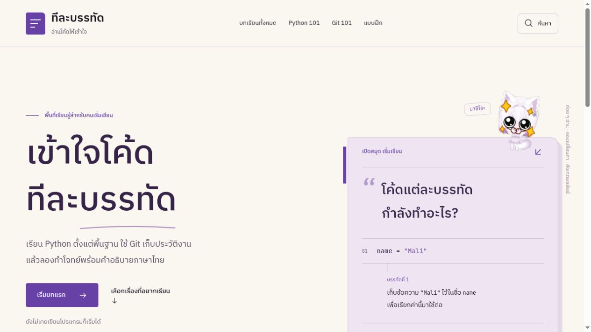
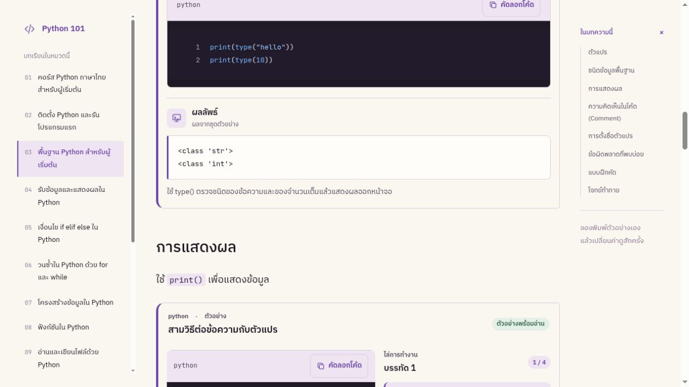

<p align="center">
  
</p>
<h1 align="center">ทีละบรรทัด</h1>
<p align="center"><strong>อ่านโค้ดให้เข้าใจ แล้วลองเปลี่ยนค่าด้วยตัวเอง</strong></p>
<p align="center">เว็บเรียน Python และ Git ภาษาไทยสำหรับผู้เริ่มต้น<br />มีมาชิโระอยู่เป็นเพื่อนอ่าน โค้ดให้ลอง และแบบฝึกให้ทบทวน</p>
<p align="center">
  
  
  
  
</p>



## อ่าน ลองเขียน แล้วค่อยไปต่อ

- **27 บทเรียน** ครอบคลุม Python และ Git พร้อม **109 ตัวอย่างโค้ด**
- **โค้ดสั้นอ่านจบในกล่องเดียว** แยกโค้ดพื้นเข้มกับผลลัพธ์พื้นสว่างให้เห็นชัด
- **ไล่การทำงานทีละขั้น** ดูบรรทัดที่ทำงาน ค่าตัวแปร และผลลัพธ์ในแต่ละจังหวะ
- **ลองเปลี่ยนค่า** ในตัวอย่างที่เตรียมช่องให้แก้ แล้วรัน Python ในเบราว์เซอร์
- **เล่นอัตโนมัติ หยุด หรืออ่านช้าลง** เลือกความเร็วได้ตามจังหวะของตัวเอง
- **แบบฝึก Python 73 ข้อ** พร้อมเฉลยและคำอธิบาย
- ค้นหาด้วยภาษาไทยหรือชื่อคำสั่ง อ่านได้ทั้งมือถือและเดสก์ท็อป

ไม่ต้องสมัครบัญชี คำตอบแบบฝึกอยู่ในหน่วยความจำของหน้า และหายเมื่อรีเฟรช ไม่มีการเก็บความคืบหน้าการเรียน

<details>
<summary><strong>ดูตัวอย่างกล่องโค้ดและผลลัพธ์</strong></summary>



ตัวอย่างที่ซับซ้อนมีตัวเล่นทีละขั้น ส่วนตัวอย่างสั้นแสดงผลลัพธ์กับคำอธิบายกระชับ ไม่ต้องกดผ่านทีละบรรทัด

</details>

## เปิดบนเครื่องตัวเอง

ต้องมี **Node.js 22.22.0 ขึ้นไป** และ **Bun**

```sh
git clone https://github.com/tantaihaha4487/teelabandat.git
cd teelabandat
bun install
bun run dev
```

เปิด URL ที่แสดงใน terminal โดยปกติคือ `http://127.0.0.1:4321/`

### สร้างเว็บพร้อมใช้งาน

```sh
bun run build
bun run preview
```

ไฟล์เว็บอยู่ใน `dist/` นำไปวางบนโฮสต์ที่รองรับเว็บ static ได้ ไม่ต้องตั้งค่า API key หรือฐานข้อมูล

Python ทำงานใน Web Worker ผ่าน Pyodide ซึ่งถูกคัดลอกมาไว้กับเว็บตอนเริ่มพัฒนาหรือ build และโหลดเมื่อกดทดลอง ส่วน Git แสดงคำสั่งและคำอธิบาย ไม่สั่งงาน shell บนเครื่องผู้เรียน

## เพิ่มบทเรียนของตัวเอง

เนื้อหาแยกจากหน้าตาเว็บ เพิ่มหมวดและบทเรียนแล้วสารบัญกับเมนูจะอัปเดตจากข้อมูล

| อยากแก้อะไร | อยู่ที่ไหน |
| --- | --- |
| หมวดการเรียน | `src/content/sections/` |
| บทเรียน | `src/content/lessons/` |
| โค้ดตัวอย่าง | `src/content/examples/` |
| ขั้นตอน ค่าตัวแปร และช่องทดลอง | `src/content/teaching/` |
| คลังโจทย์ | `src/data/python-bank.json` |
| มาสคอต | `public/mascot/` |

อ่านรายละเอียดใน [CONTENT.md](CONTENT.md) และแนวทางหน้าตาเว็บใน [DESIGN.md](DESIGN.md)

<details>
<summary><strong>คำสั่งสำหรับตรวจงานและที่มาเนื้อหา</strong></summary>

```sh
bun run validate       # ตรวจโครงสร้างเนื้อหาและข้อมูลตัวอย่าง
bun run check          # ตรวจ Astro และ TypeScript
bun run build          # ตรวจเนื้อหาและสร้างเว็บ
bun run check:routes   # ตรวจลิงก์และเส้นทางจาก dist/
```

การเทียบกับ Python101, Git101 และ Wayo ต้นฉบับจะทำเมื่อมีไฟล์อ้างอิงบนเครื่อง หากไม่มี จะข้ามเฉพาะการเทียบต้นฉบับและแจ้งไว้ในผลคำสั่ง

เนื้อหาเรียบเรียงจาก Python101, Git101 และคลังโจทย์ Wayo โดยเก็บโค้ด คำสั่ง ผลลัพธ์ และลำดับตัวเลือกเดิม ตัวอย่างสำหรับฝึกแก้ข้อผิดพลาดยังคงผิดตามต้นฉบับและมีป้ายบอก

ดูบันทึกการเรียบเรียงด้วย Claude และ Humanizer ใน [docs/editorial](docs/editorial) และที่มามาสคอตใน [docs/mascot-assets.md](docs/mascot-assets.md)

</details>

---

<p align="center">
  <br />
  <sub>เรียนได้ตามจังหวะของตัวเอง</sub>
</p>
